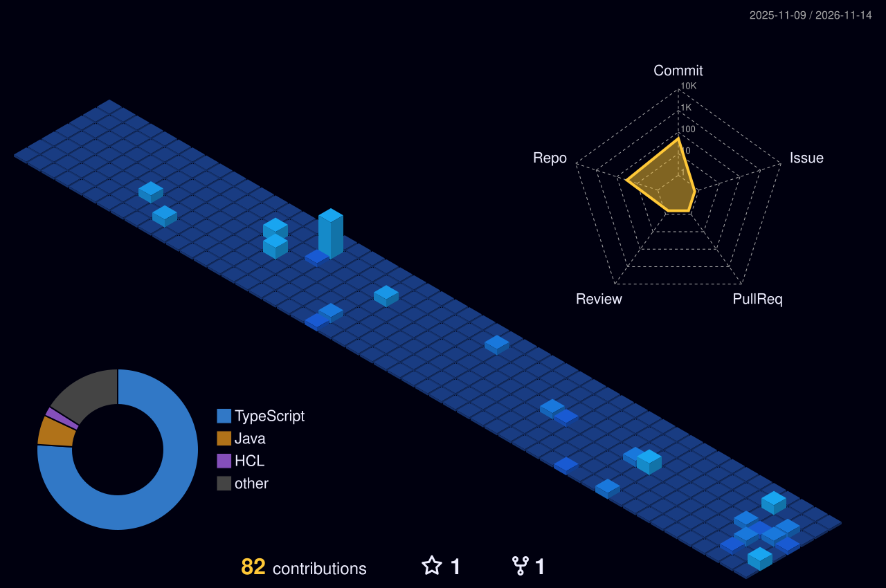

<!-- 🎬 1. HERO — Camera Viewfinder + Name + Dynamic Roles -->

  

<!-- 🏗️ 2 & 3. WHAT I BUILD & HOBBIES CAROUSEL -->

  

<!-- ⚛️ 4. TECH ORBIT & CHIP GRID ARSENAL -->

  

<!-- 🪪 5. HOLOGRAPHIC ID BADGE & PRODUCTION DASHBOARD -->

  

## 🚀 S-Rank Production Deployments & Systems

<table>
<tr>
  <th align="left">Mission / Project</th>
  <th align="left">Platform Description &amp; Architecture</th>
  <th align="left">Tech Arsenal</th>
  <th align="center">Scope</th>
</tr>

<tr>
  <td><a href="https://github.com/dsriharikrishna"><b>ORKA.AI</b></a></td>
  <td><b>Enterprise AI Operations Platform</b> — Dataset lifecycle management, dynamic layer configurations, model benchmarking, annotator task queues, and schema mappers.</td>
  <td><code>Next.js</code> <code>React</code> <code>TypeScript</code> <code>Redux Toolkit</code> <code>React Query</code> <code>Tailwind</code></td>
  <td align="center"><b>Production</b></td>
</tr>

<tr>
  <td><a href="https://github.com/dsriharikrishna"><b>Orkemy</b></a></td>
  <td><b>AI Workforce &amp; Contributor Platform</b> — Contributor task allocation, multi-role evaluation interfaces, and precision labeling workflows.</td>
  <td><code>Next.js</code> <code>React</code> <code>TypeScript</code> <code>TanStack Table</code> <code>REST APIs</code></td>
  <td align="center"><b>Production</b></td>
</tr>

<tr>
  <td><a href="https://github.com/dsriharikrishna"><b>SanathanaVani</b></a></td>
  <td><b>Media Management Platform</b> — Streaming audio, video, podcasts, and digital library with role-based access control and analytics.</td>
  <td><code>Next.js</code> <code>React</code> <code>TypeScript</code> <code>Tailwind CSS</code> <code>REST APIs</code></td>
  <td align="center"><b>Enterprise</b></td>
</tr>

<tr>
  <td><a href="https://github.com/dsriharikrishna"><b>Educare.AI</b></a></td>
  <td><b>School Management Ecosystem</b> — Multi-role workflows for Admins, Teachers, and Parents with real-time analytics.</td>
  <td><code>Next.js</code> <code>React</code> <code>TypeScript</code> <code>Redux Toolkit</code></td>
  <td align="center"><b>Enterprise</b></td>
</tr>

<tr>
  <td><a href="https://github.com/dsriharikrishna"><b>Pronto</b></a></td>
  <td><b>Booking &amp; Operations Dashboard</b> — High-throughput CRUD data tables, live status monitoring, and administration consoles.</td>
  <td><code>React</code> <code>Node.js</code> <code>Material UI</code> <code>REST APIs</code></td>
  <td align="center"><b>Dashboard</b></td>
</tr>

<tr>
  <td><a href="https://github.com/dsriharikrishna"><b>Fit4Hire AI</b></a></td>
  <td><b>AI Career &amp; ATS Resume Builder</b> — Automated resume parsing, keyword scoring algorithms, and LinkedIn optimization.</td>
  <td><code>React</code> <code>Redux Toolkit</code> <code>Tailwind CSS</code></td>
  <td align="center"><b>AI SaaS</b></td>
</tr>

<tr>
  <td><a href="https://github.com/dsriharikrishna"><b>Cloud Deployments</b></a></td>
  <td><b>AWS ECS/ECR &amp; S3 Pipeline</b> — Dockerized containerized applications deployed on AWS ECS with ALB, S3 hosting, and Terraform fundamentals.</td>
  <td><code>AWS ECS</code> <code>ECR</code> <code>S3</code> <code>Docker</code> <code>Nginx</code></td>
  <td align="center"><b>Cloud / DevOps</b></td>
</tr>
</table>

 
<a href="https://github.com/dsriharikrishna?tab=repositories"><b>→ Explore all production &amp; open-source repositories</b></a>
  

### 🌃 3D Contribution Skyline

*Every commit builds another skyscraper — automatically rendered in real-time.*

  

<!-- 💌 7. CONNECT FOOTER -->

 

&nbsp;

&nbsp;

&nbsp;

  

  

**⚡ Build • Ship • Scale — Striving for Engineering Excellence.**

